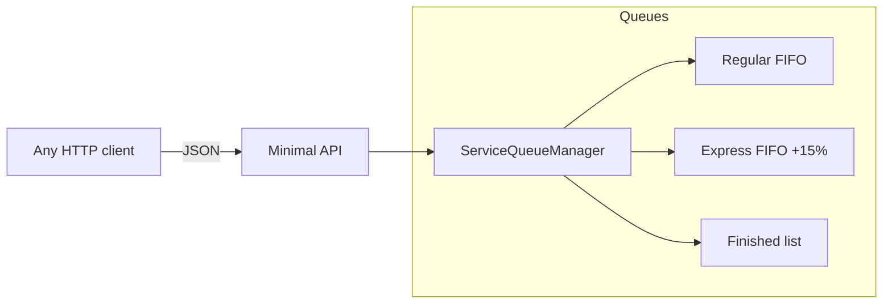

# Icarus Fleet

[](https://github.com/Brumertz/Icarus-Fleet/actions/workflows/ci.yml)
[](https://dotnet.microsoft.com/)
[](LICENSE)

> Service queue API for drone maintenance: Regular and Express FIFO queues,
> sequential service tags and atomic pricing — the web evolution of the
> [Icarus_Drone_Service_App](https://github.com/Brumertz/Icarus_Drone_Service_App)
> WPF desktop application.

## Origin story

Icarus Fleet started as a WPF desktop app built for a TAFE assessment: logging
drone service jobs (regular and express) using queues. This repository rebuilds
the same domain as a modern **ASP.NET Core minimal API** — same business rules,
now consumable by any client (web, mobile, CLI) and ready for the real-time
dashboard planned in the roadmap.

The queue domain was ported 1:1 from the original implementation:
Title Case client names, Sentence Case problem descriptions, 2-decimal costs,
sequential tags from 100 and the 15% Express surcharge.

## Features

- **Dual FIFO queues** — Regular and Express jobs processed independently
- **Atomic Express surcharge** — +15% applied at enqueue time, rounded to 2 decimals
- **Sequential service tags** — 100, 110, 120… assigned automatically
- **Finished list** — processed jobs keep their completion timestamp
- **Input validation** — clear 400 responses for missing/negative fields
- **Thread-safe** — singleton manager behind a single lock, safe under concurrent requests
- **String enums** — JSON payloads read naturally (`"priority": "Express"`)

## Architecture



## API

| Method | Endpoint | Description |
| :--- | :--- | :--- |
| `GET` | `/health` | Liveness check |
| `GET` | `/api/services` | Snapshot of both queues, finished list and next tag |
| `POST` | `/api/services` | Create a job (auto tag, surcharge applied for Express) |
| `POST` | `/api/services/{tag}/process` | Move a queued job to Finished |
| `DELETE` | `/api/services/finished/{tag}` | Remove a finished job |

### Examples

```bash
# Create an Express job (base cost 100 → 115 after the 15% surcharge)
curl -X POST http://localhost:5000/api/services \
  -H "Content-Type: application/json" \
  -d '{"clientName":"ana torres","droneModel":"DJI Mavic 3","problem":"broken propeller","cost":100,"priority":"Express"}'

# Process service 100
curl -X POST http://localhost:5000/api/services/100/process

# Full state
curl http://localhost:5000/api/services
```

## Getting started

```bash
git clone https://github.com/Brumertz/Icarus-Fleet.git
cd Icarus-Fleet
dotnet run --project src/IcarusFleet.Api
```

The API listens on the URL printed in the console (e.g. `http://localhost:5000`).

## Tests

```bash
dotnet test
```

13 xUnit tests cover tags, surcharge math, formatting rules, FIFO order,
validation errors and the finished lifecycle. CI runs build + tests on every
push and pull request.

## Roadmap

- [ ] SignalR hub for real-time queue updates
- [ ] React + TypeScript dashboard (the original plan of the desktop app)
- [ ] Persistence with EF Core + PostgreSQL
- [ ] Docker / docker-compose
- [ ] JWT authentication
- [ ] Integration tests with `WebApplicationFactory`

## License

[MIT](LICENSE) © 2026 Brumertz
